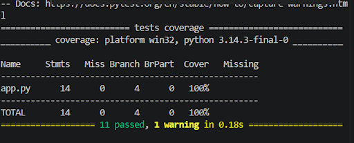
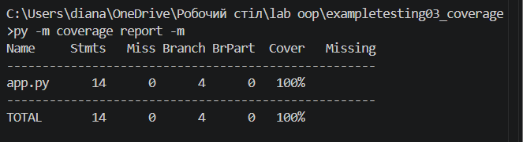
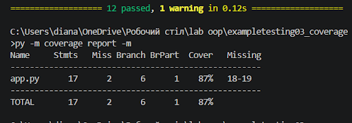
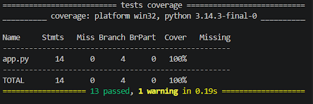
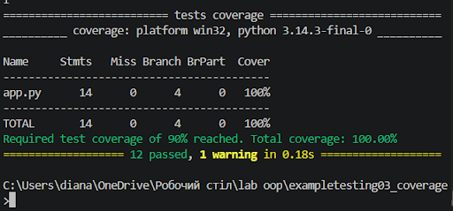
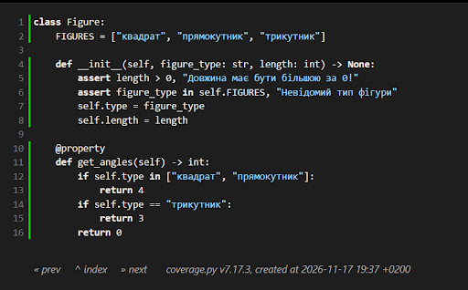
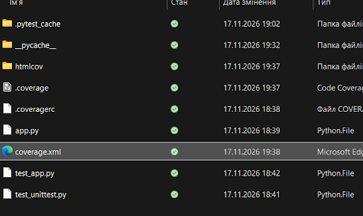

# Звіт до роботи
**Тема:** Покриття коду тестами (Code Coverage) у Python  
**Мета роботи:** Навчитися вимірювати покриття коду рядками та розгалуженнями за допомогою `coverage.py` і `pytest-cov`, налаштовувати `.coveragerc`, виключати непотрібний код (`pragma: no cover`) та генерувати HTML- і XML-звіти.

---

## Виконання роботи

### 1. Команди запуску тестів
Для ізольованого вимірювання покриття `unittest` та `pytest` перед кожним запуском очищався кеш через `coverage erase`:

```bash
# Окремий запуск для unittest
py -m coverage erase
py -m coverage run -m unittest discover
py -m coverage report -m

# Окремий запуск для pytest
py -m coverage erase
py -m coverage run -m pytest
py -m coverage report -m

# Перевірка порогу покриття 90%
py -m pytest --cov=app --cov-branch --cov-fail-under=90

```

### 2. Покриття до і після додавання тестів. Line vs Branch coverage

* **До додавання тестів:** при тестуванні лише трикутника гілка для квадрата та прямокутника у `get_angles` залишалася невиконаною.
* **Після додавання тестів:** додано тести для всіх фігур (`квадрат`, `прямокутник`, `трикутник`) та перевірки помилок вхідних даних — досягнуто **100% покриття** (`14 Stmts`, `0 Miss`, `4 Branch`, `0 BrPart`).

> << **Різниця між Line та Branch coverage:**
> **Line coverage** показує, чи виконався кожен рядок коду хоча б один раз.
> **Branch coverage** перевіряє, чи пройшли тести обидва напрямки кожної умови (`True` та `False`). >>

### 3. Результати окремих запусків `unittest` та `pytest`

* **Запуск `pytest` (11 тестів пройдено, покриття 100%):**


* **Запуск `unittest` (покриття 100%):**


### 4. Налаштування `.coveragerc` та експеримент із `pragma: no cover`

У файлі `.coveragerc` вказано `source = .`, `branch = true`, а тестові файли (`test_*.py`) виключено через `omit`, щоб у звіті відображався лише `app.py`.

* **До додавання `# pragma: no cover`:** блок `if __name__ == "__main__":` не виконувався під час тестів, покриття знизилося до **87%** (рядки `18-19` у `Missing`):


* **Після додавання `# pragma: no cover`:** точку входу виключено з аналізу, покриття повернулося до **100%**. Використовувати цей тег доцільно лише для коду, який свідомо не тестується (як-от точка входу скрипта), а не для приховування неперевіреної логіки.

### 5. Експеримент із тестом без `assert` та поріг покриття

Додано тимчасовий тест для `get_angles` без `assert`:

```python
def test_angles_no_assert():
    fig = Figure("трикутник", 3)
    _ = fig.get_angles

```


> << **Висновок:** 100% line coverage не гарантує відсутності багів, оскільки `coverage` перевіряє лише факт виконання рядків, а не правильність повернутого значення. Лише `assert` гарантує відповідність результату очікуваному. >>

Перевірка мінімального порогу покриття у **90%** (`--cov-fail-under=90`) пройшла успішно:


### 6. HTML- та XML-звіти та `.gitignore`

Згенеровано звіти командами `py -m coverage html` та `py -m coverage xml`. До `.gitignore` додано службові файли (`__pycache__/`, `.coverage`, `htmlcov/`, `.pytest_cache/`).

* **HTML-звіт (`htmlcov/app_py.html`)** — призначений для візуального перегляду людиною в браузері (зеленим підсвічено виконані рядки):


* **XML-звіт (`coverage.xml`)** — призначений для автоматизованого аналізу CI/CD-системами (GitHub Actions, Codecov тощо).


---

## Висновок

* **Що зроблено:** Налаштовано вимірювання покриття коду для `app.py`, створено конфігурацію `.coveragerc` та `.gitignore`, виконано окремі запуски `pytest` і `unittest`, проведено експерименти з `pragma: no cover` і тестом без `assert`, згенеровано HTML- та XML-звіти.
* **Чи досягнуто мети та чи виконано всі завдання:** Так, усі основні та додаткові завдання виконано, досягнуто 100% покриття рядків і розгалужень.
* **Нові знання:** Засвоєно роботу з `coverage.py` і `pytest-cov`, різницю між line та branch coverage і призначення різних форматів звітів.
* **Складності:** Команда `poetry` не розпізнавалася в терміналі Windows через налаштування `PATH`, тому всі команди успішно виконано напряму через `py -m`.
* **Feedback та побажання:** Немає, все добре

